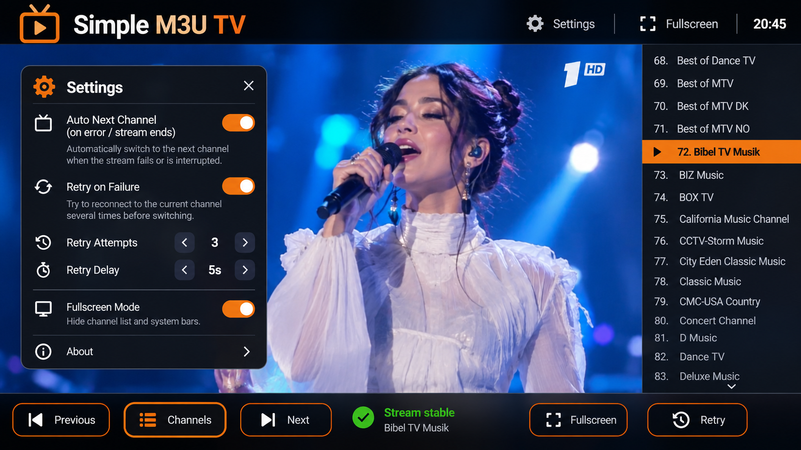

# Simple M3U TV

A lightweight **M3U/M3U8 playlist player** for Android TV and phones, built with Kotlin and Media3.

## ✨ Features

- 📺 Optimized for Android TV with full D-pad navigation
- 🔍 Instant channel search by **name** or **channel number**
- 📂 Load local M3U / M3U8 playlists from device storage
- 🎯 Orange focus cursor follows the selected row (not the playing one)
- 🔔 Media3 playback with system media controls
- 🪶 Minimal UI — no accounts, no ads, no tracking
- 📱 Works on phones too (Android 6.0+)

## ☕ Support Me
If you find this project helpful, you can buy me a coffee!

## New: Channel search

The right-hand channel list now contains a Search field. Type a channel name or fragment (for example `History`) to show only matching entries. Type an exact channel number (for example `72`) to locate that playlist entry. The original channel numbers remain visible in the filtered results. Search never starts playback: it highlights the first match, and you select a result by clicking it or pressing OK on a remote. Clearing Search restores the complete list.

Android TV: navigate to the Search field with the D-pad and press OK to type using your TV keyboard. Press keyboard Search to focus the first result without playing it. Arrow keys navigate matches and OK starts the chosen channel.

All previous v1.7.2 features, settings, About/avatar, Android 7 local browser, and Media3 playback are preserved. Minimum Android is still API 23 (Android 6).

Build via `.github/workflows/build-apk.yml`.

## v1.8.1 — Android TV D-pad scrolling fix
- Orange cursor now follows the focused channel row, not the channel currently playing.
- ScrollView keeps the focused row entirely on-screen while pressing Up/Down, including filtered Search results.
- Auto-hide no longer steals focus from the channel list after 3 seconds.
- All other features and Android 6.0+ compatibility preserved.
